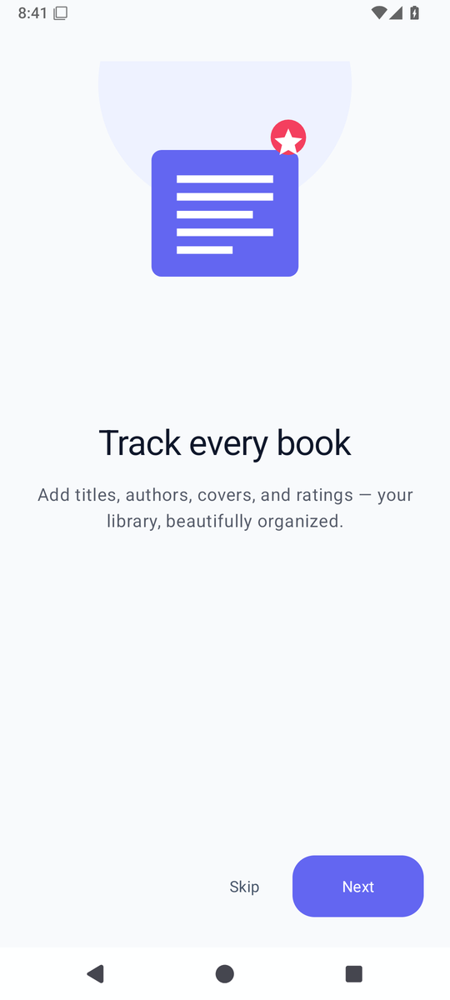
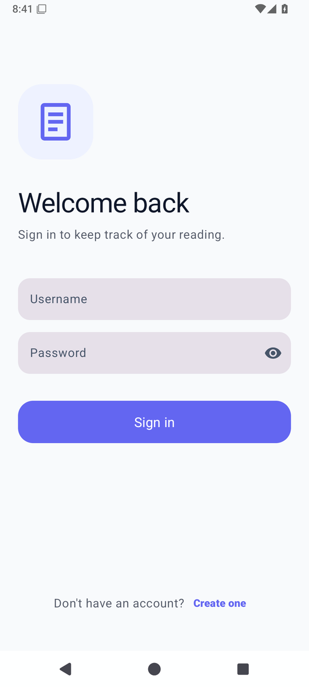
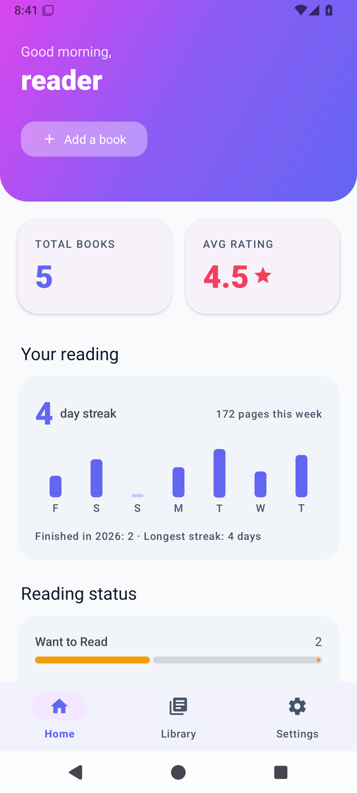
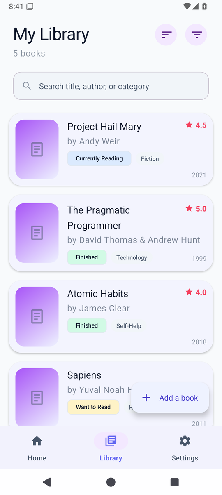
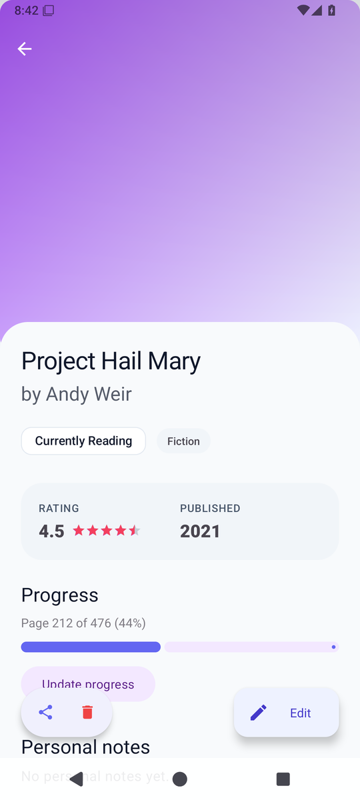
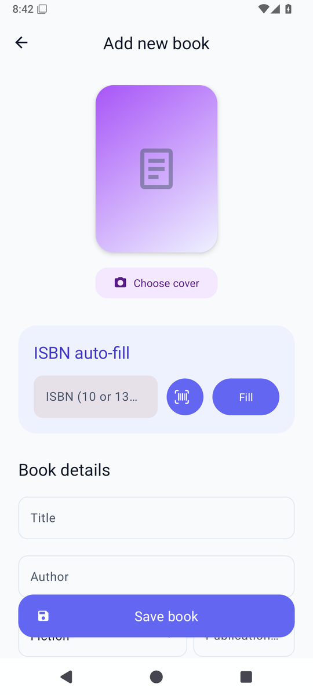
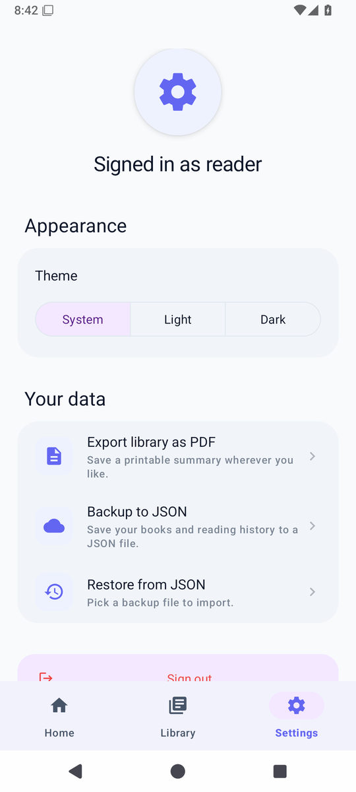
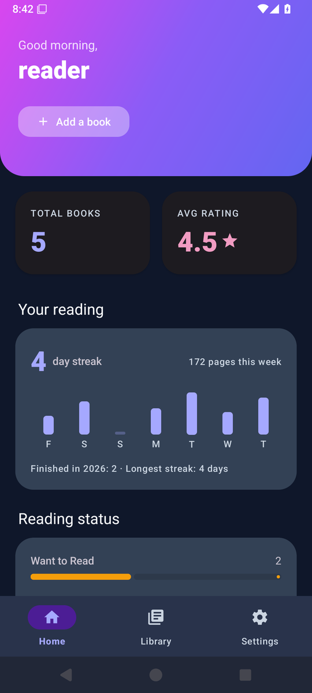
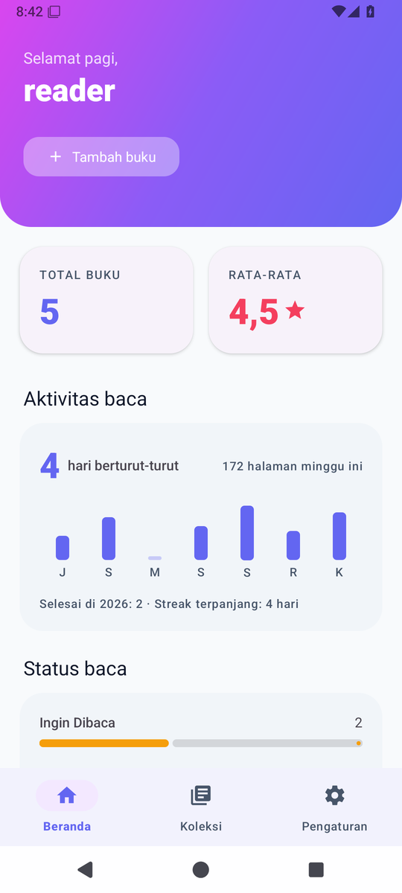

# Mini Book Library

[](https://github.com/SultanZhalifa/MiniBookLibrary/actions/workflows/android.yml)
[](https://kotlinlang.org/)
[](https://developer.android.com)
[](https://developer.android.com)
[](LICENSE)

An offline-first Android app for keeping track of the books I read. Sign in, add books with covers and ratings, mark them as want-to-read / reading / finished, and export the whole library to PDF or JSON when you need to.

I started this as a small Java + raw SQLite project for class. After it worked, I rewrote it from scratch in Kotlin with MVVM, Room, Coroutines, and Material 3 so I had something I could actually point to in interviews.

## Features

Library:

- Add, edit, and delete books with title, author, year, category, cover image, and personal notes.
- Live search across title, author, and category as you type.
- Sort by title, date added, or rating. Filter by reading status. Both choices stick across launches.
- Swipe a row to delete with an Undo snackbar so accidental swipes don't lose data.

Reading tracker:

- Three reading states: Want to Read, Currently Reading, Finished.
- Page progress (current / total) for books you're actively reading, with a progress bar.
- An Update progress button on the detail screen, so logging tonight's pages doesn't mean opening the whole edit form.
- 1 to 5 star rating per book, sortable, also rolled up into a dashboard average.

Dashboard:

- Greeting that changes with time of day.
- Total count, average rating, and a status breakdown with colored progress bars.
- Reading streak, pages per day for the last week, longest streak, and books finished this year. Every time a book's current page moves forward, the difference is logged for that day, and the numbers come from that log.
- Recently added books in a horizontal rail at the bottom.

Cover images:

- Pick from gallery using the platform Photo Picker, which doesn't need any runtime permission on Android 13+.
- The picked image is downscaled to 1200px (EXIF rotation applied) and copied into internal storage, so the cover survives reinstalls and Auto Backup without keeping a 6 MB photo around.
- Image loading via Coil.

ISBN auto-fill:

- Scan the barcode on the back cover (CameraX + ML Kit, bundled model so it works without Play Services), or type a 10 or 13 digit ISBN and tap Fill.
- ISBNs are checksum-validated before anything hits the network. That matters for the scanner: every product barcode in frame is an EAN-13, and only the 978/979 ones with a valid check digit are books. The app calls the public Google Books API and fills in title, author, year, category, and page count.
- It only fills fields you haven't typed in yet. Anything you've already entered is left alone.
- No new dependencies for this. It uses `HttpURLConnection` and `org.json` which are both on the platform.
- 8 second timeout so a flaky connection doesn't sit and spin.

Export and backup:

- Export the whole library to PDF using the platform `PdfDocument` API.
- JSON backup of books and reading history. Both use the system save dialog, so you choose where the file goes (Downloads, Drive, wherever) and the app needs no storage permission on any Android version.
- Restore appends imported books rather than replacing the existing ones, so you can merge backups without losing anything. Old (schema 1) backups still import.

Home-screen widget:

- Shows the book you most recently updated while Currently Reading, with its cover and page progress. Tapping it opens the app.

Account and UX:

- Login and registration with PBKDF2-HMAC-SHA256 password hashing (600k iterations). Plaintext is never persisted.
- English and Bahasa Indonesia, following the phone's language.
- Edge-to-edge on every screen, as Android 15+ requires.
- Theme picker: Follow system, Light, or Dark. Uses Material 3 color tokens so both modes look right.
- Three-slide onboarding on first launch, ViewPager2 with dot indicators. Skippable.
- Session is held in `SharedPreferences` so the app opens straight to the dashboard once you've signed in.

## Architecture

Single-activity for the post-login app, plus separate activities for onboarding and auth so each lives in its own navigation graph. State flows in one direction: Room emits data, the ViewModel shapes it into a `StateFlow<UiState>`, the Fragment collects it.

```
UI (Activities + Fragments)
  collects StateFlow
       |
ViewModels
  AuthViewModel, DashboardViewModel, BookListViewModel,
  BookDetailViewModel, AddEditBookViewModel, SettingsViewModel
       |
  suspend / Flow
       |
Repositories
  UserRepository, BookRepository
       |
       +-- Room (UserDao, BookDao, ReadingLogDao)
       +-- PreferencesManager (theme, session, last sort/filter)
       +-- GoogleBooksService (ISBN lookup)
```

A few things worth calling out:

- Room is the source of truth. The dashboard, library list, and counters each subscribe to their own `Flow` from the same DAOs and re-render independently. Nothing is pushed; everything is derived.
- The Repository layer is the only thing that knows about Room. If I ever swap to a remote API, no ViewModel needs to change.
- DI is a hand-rolled `ServiceLocator`. Hilt would have been fine but felt heavy for one module, and a small container is easier for someone to read in 30 seconds.
- The `GoogleBooksParser` is split off from the service so I can hit it with JSON fixtures in a JVM unit test without touching the network.

## Tech stack

| Layer | What |
| --- | --- |
| Language | Kotlin 2.0 |
| Architecture | MVVM with Repository, single-Activity + Navigation Component |
| Async | Kotlin Coroutines + Flow / StateFlow |
| Database | Room 2.6 (KSP), schema snapshots committed in `app/schemas` |
| UI | Material 3, ViewBinding, ConstraintLayout, ViewPager2 |
| Image loading | Coil 2.7 |
| Networking | `HttpURLConnection` + `org.json` (no extra deps) |
| PDF export | Android `PdfDocument` |
| Barcode | CameraX + ML Kit barcode scanning |
| Tests | JUnit 4, MockK, Turbine, kotlinx-coroutines-test, Room testing on Robolectric |
| CI | GitHub Actions (build, unit tests, debug APK artifact) |

## Project layout

```
app/src/main/java/com/example/minibooklibrary/
  MiniBookLibraryApp.kt           Application class, applies persisted theme on startup
  di/ServiceLocator.kt            Hand-rolled DI container
  domain/                         Plain Kotlin, no Android imports
    ReadingStatus.kt              Want / Reading / Finished
    SortOrder.kt                  Sort options
    StatusFilter.kt               Library filter
    BookLookup.kt                 Result type for ISBN auto-fill
    ReadingStats.kt               Streak and weekly pages, computed from the reading log
  data/
    local/
      BookDatabase.kt             Room database singleton (schema history in the KDoc)
      ImageStorage.kt             Downscales picked covers into internal storage
      dao/                        UserDao, BookDao, ReadingLogDao
      entity/                     UserEntity, BookEntity, ReadingLogEntity
    preferences/                  Typed SharedPreferences wrapper
    remote/                       Google Books client + parser
    repository/                   UserRepository, BookRepository: suspend writes, Flow reads
    backup/                       JSON backup I/O (BackupManager) and file format (BackupJson)
    export/                       PdfDocument-based PDF exporter
  ui/
    RouterActivity.kt             Decides where the launcher should go
    onboarding/                   ViewPager2 onboarding
    auth/                         Login + Register fragments
    main/MainActivity.kt          Bottom-nav host
    dashboard/                    Home screen
    books/{list, detail, edit}    Library, detail, add/edit, barcode scanner
    settings/                     Theme, backup/restore, PDF export
    widget/                       Currently Reading home-screen widget
    common/                       ViewModelFactory, view/inset helpers, enum labels
  util/                           Pure helpers: PasswordHasher, Isbn, date formatting

app/src/test/...                  Mirrors the same package structure
app/schemas/                      Room schema snapshots, one JSON per version (committed)
```

Navigation between screens goes through Safe Args (`*Directions` / `*Args`), so a renamed or retyped argument is a compile error rather than a silent `0L`.

## Running it

You'll need:

- Android Studio Hedgehog (2023.1.1) or newer
- JDK 17 (or the JBR that ships with Android Studio)
- An emulator or device on API 26 or higher

Then:

```bash
git clone https://github.com/SultanZhalifa/MiniBookLibrary.git
cd MiniBookLibrary
./gradlew assembleDebug
```

Open the project in Android Studio and hit Run. On first launch you'll go through onboarding, register an account, and land on an empty dashboard. Tap Add a book to start filling it in. The Settings tab has the theme toggle, PDF export, and backup buttons.

## Tests

```bash
./gradlew testDebugUnitTest
```

The suite covers these classes:

- `PasswordHasherTest` covers determinism, salt isolation, verify success/failure, the legacy SHA-256 format, and when a hash needs upgrading.
- `IsbnTest` covers ISBN-10/13 checksums, the `X` check digit, hyphens, and non-book EAN-13 barcodes.
- `ReadingStatsTest` covers streaks across today/yesterday, gaps, the longest run, and the 7-day window.
- `BackupJsonTest` round-trips a backup, imports a schema 1 file, and clamps hand-edited junk.
- `BookDatabaseMigrationTest` creates a v1 database from the committed schema and migrates it to the current version on Robolectric, so a broken migration fails in CI rather than on someone's phone.
- `EnumStorageTest` pins the persisted string values for `ReadingStatus`, `SortOrder`, and `StatusFilter` so a future rename can't silently break existing user data.
- `UserRepositoryTest` covers register validation, duplicate username handling, password hashing (never plaintext), login success and failure, upgrading old hashes on login, session persistence, and dropping a session whose user is gone.
- `BookRepositoryTest` checks timestamps, Undo restore, reading-log entries when the page moves forward (and not backward), and `finishedAt`.
- `GoogleBooksParserTest` walks the JSON parser through happy path, missing fields, multiple authors, taxonomy splitting (Google returns nested categories like `Fiction / Romance`), and year extraction. Plus service-level paths for short ISBNs and null HTTP responses.
- `AuthViewModelTest` covers login state transitions, register validation, error consumption, and the logout event.
- `BookListViewModelTest` covers search, status filter, A-Z sort, sort/filter persistence, swipe-delete, and Undo restore.
- `AddEditBookViewModelTest` covers form validation (title, year range, page progress), saving new books, edit hydration, and ISBN auto-fill including the rule that user-typed input is never overwritten.

CI also fails if a change to the Room entities isn't accompanied by its new schema snapshot in `app/schemas`, and on any Android Lint error.

On top of the unit tests, a second CI job boots an Android 15 emulator and runs `ScreenshotTourTest`: it registers, signs in, seeds a few books and five days of reading, then walks every screen in light, dark and Indonesian, saving a screenshot of each (the `screenshots` artifact) and checking the window is really drawn edge-to-edge. That tour is what caught the detail and settings screens crashing on open, and dark mode being laid out inside the system bars after a theme switch.

## Screenshots

Captured on an Android 15 emulator by the screenshot tour in CI (see Tests), so they show the current build, system bars included.

| Onboarding | Login | Dashboard |
| :---: | :---: | :---: |
|  |  |  |

| Library | Book detail | Add / Edit |
| :---: | :---: | :---: |
|  |  |  |

| Settings | Dark mode | Bahasa Indonesia |
| :---: | :---: | :---: |
|  |  |  |

## Roadmap

Things I'd like to add next, roughly in priority order:

- A yearly reading goal on top of the "finished this year" count.
- Book recommendations based on rating history.
- Cloud sync (probably Firebase, since it's the lowest-friction option).

## Download

CI uploads a debug APK as a workflow artifact on every push to a tracked branch, so the easiest way to grab a build is from the latest run on the [Actions tab](https://github.com/SultanZhalifa/MiniBookLibrary/actions). For a release build:

```bash
./gradlew assembleRelease
# Output: app/build/outputs/apk/release/app-release.apk
```

This is unsigned by default. Set up a signing config in `app/build.gradle.kts` if you want to install on a real device long-term.

## Notes on a few decisions

These are the calls I had to think about more than once while building this:

- **Hand-rolled JSON instead of kotlinx-serialization or Moshi.** The schemas are tiny (book entity, backup file, Google Books volumeInfo) and the dependency cost felt larger than the benefit. The parser tests use the same `org.json` impl that runs on the device, added explicitly as a `testImplementation` so unit tests don't get the stub jar's no-op version.
- **Plain `HttpURLConnection` instead of OkHttp.** One unauthenticated GET endpoint doesn't justify another transitive dependency. The `HttpClient` interface in `GoogleBooksService` makes the network layer trivial to fake in tests.
- **`ServiceLocator` instead of Hilt.** I weighed both. For a single-module app where I wanted readers to follow the dependency graph by clicking through the source rather than reading codegen, a 60-line `object` won.
- **Reactive read, suspend write.** Repositories return cold `Flow` for reads (Room handles invalidation) and `suspend` for writes. ViewModels collect with `repeatOnLifecycle` so the UI doesn't waste work in the background.
- **PBKDF2 instead of bcrypt or Argon2.** v1 used a single round of salted SHA-256, which stops rainbow tables but not a GPU. PBKDF2-HMAC-SHA256 ships with the platform, so it costs no dependency. Stored hashes record their own algorithm and iteration count, and old SHA-256 hashes are upgraded the next time that user signs in, since that's the only moment the app sees the password. Argon2 would be better still but needs a native library.
- **minSdk 26.** PBKDF2-HMAC-SHA256 and `java.time` both arrive in API 26. Devices older than that are a low single-digit share of active Android phones.
- **Storage Access Framework for exports.** Writing straight into public Downloads needs `WRITE_EXTERNAL_STORAGE` below API 29, which the app didn't have, so exports crashed on those phones. The system save dialog works the same everywhere and lets people put the file somewhere useful.
- **No destructive migration fallback.** Schema snapshots are committed and the v1 to v2 migration is generated by Room and tested in CI. Losing someone's library because a migration was missing is worse than a crash in testing.
- **Reading log without a foreign key to books.** Deleting a book shouldn't rewrite history and break a streak, and log rows restored from a backup have no book to point at.
- **Categories aren't translated.** The chosen category is stored with the book, so translating the list would mix languages inside one library.

## License

MIT. See [LICENSE](LICENSE).
